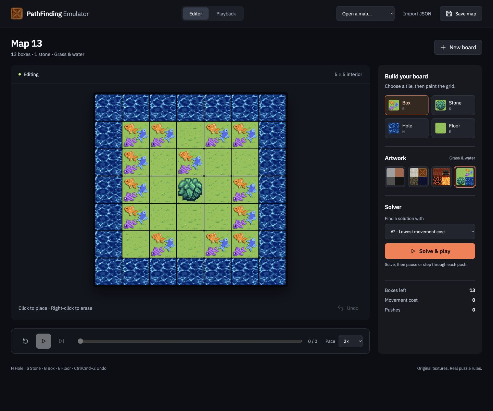
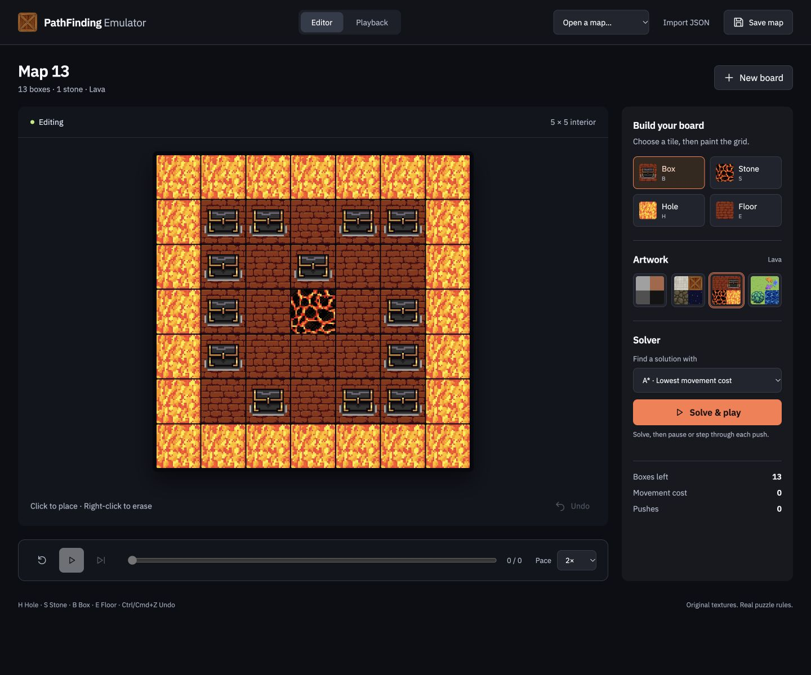
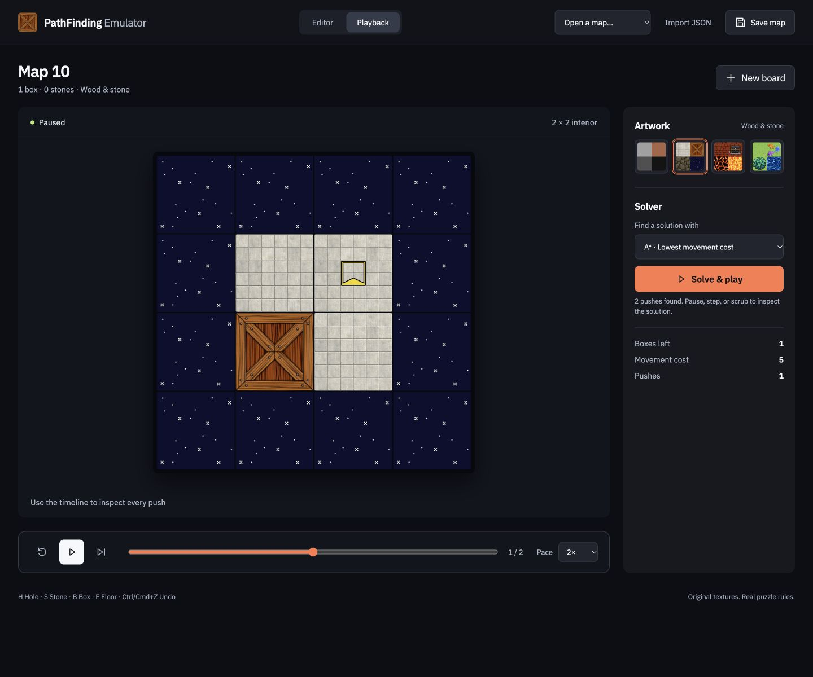

# PathFinding Emulator

A local browser puzzle editor and simulator with the original textured artwork.
Paint a board, open one of 14 sample maps, and watch boxes move into holes while
tracking movement cost. The Python engine still owns every puzzle rule.

## The browser workspace

The grass, water, lava, rock and crate textures are the project's original assets.
Switch artwork without changing the puzzle. These images show the **running app**,
including an actual solver frame, rather than design mockups.



| Lava artwork | Inspect a solution |
|---|---|
|  |  |

The interface adapts to narrow windows and provides keyboard board editing,
undo, live artwork previews, pause, step, reset and timeline scrubbing.
See [screenshot capture notes](docs/screenshots/README.md).

## Setup and run

Use **Python 3.11–3.13**. The browser app needs no third-party runtime packages.
From the repository directory:

```sh
python3.12 Main.py
```

On Windows: `py -3.12 Main.py`. This starts the local server at
`http://127.0.0.1:8765` and opens your browser. Keep that process running while
using the app; Ctrl+C stops it. If the port is occupied, use `--port 0` to choose
a free port. `--no-browser` starts it without opening a tab.

For an installed command, run `python -m pip install .`, then
`pathfinding-emulator`. `python -m pathfinding_emulator` also works.
For the optional Pygame interface, install `python -m pip install '.[desktop]'`
(or `-r requirements.txt`) and launch with `--desktop`. Pygame is not imported
by browser or headless runs.

Run a sample without a display:

```sh
python -m pathfinding_emulator --headless --map map_10 --algorithm A_Star
python Main.py --headless --height 2 --width 2 --seed 42
```

Failures return exit code 1 with a reason; invalid command syntax returns 2;
interruptions return 130. Successful runs print action count and total cost.

## Puzzle rules and agents

Maps are rectangular integer grids: `-2` stone, `-1` hole, `0` floor, `1` box.
The outer border must consist of holes or stones. A push moves an entire
contiguous chain of boxes one cell; its front box disappears into a hole.
Stones block movement. Actions use **row, column, direction**, with zero-based
coordinates including the border.

A push costs the chain length plus a starting penalty of 4. Continuing from the
next cell in the same direction can waive the penalty, unless the chain more
than doubles. Legacy blocked/no-box scoring is preserved for direct simulation
calls; supported agents choose only pushes that change the board.

- `random` (default): seeded edge-oriented pushes with a legal fallback.
- `A_Star`: uniform-cost search (A* with zero heuristic), minimizing simulator
  cost. The original edge heuristic was not admissible for this puzzle.
- `IDS`: iterative deepening with path-cycle prevention, minimizing action
  count within configured limits, rather than movement cost.

No-solution and resource-limit errors are distinct. A limit means solvability
is unknown. Large boards can require substantial search time and memory.
Random generation is bounded and does **not** guarantee solvability.

## Browser workflow

Open a sample from the map library, import a JSON grid, or create an empty or
random board. Dimensions mean **interior cells**, up to 20 × 20. Select a tile
and click or drag to paint; right-click erases. Borders stay holes or stones.
Undo restores the previous edit. Save map creates a new JSON file in `--maps-dir`.
There are no tile quotas in the browser editor.

Choose Random, A* or IDS, then Solve & play. Pause, step forward, reset, or scrub
through the real solution frames. Pace adjusts the time between pushes. Returning
to Editor restores the original edited board; editing discards the old solution.
Search and replay are bounded; errors explain when a board is unsolvable or a
limit prevents finding a solution. The smaller maps 10–12 are quick starting points.

Keyboard: Tab enters the board, arrow keys choose a cell, Space/Enter paints,
Delete/Backspace erases, H/S/B/E selects hole/stone/box/floor, Ctrl/Cmd+Z undoes,
and Escape returns to editing. Controls have accessible labels and visible focus;
reduced-motion preferences remove tile flashes.

The optional desktop interface retains its launcher, setup fields and tile quotas.
Its H/S/B palette shortcuts, Escape navigation and minus/plus delay controls remain.
Headless generation supports up to 100 × 100 interior cells.

## Configuration

CLI arguments override the defaults below; there are no application environment
variables or configuration files. Settings are validated once at startup.

| Argument | Default | Meaning |
|---|---|---|
| `--headless` | off | Simulate without browser or Pygame |
| `--desktop` | off | Open the optional Pygame interface |
| `--no-browser` | off | Start the browser server without opening a tab |
| `--port` | 8765 | Loopback HTTP port; 0 chooses a free port |
| `--map` | none | File path or bundled sample name |
| `--height`, `--width` | 2, 2 | Interior size when generating a headless board |
| `--maps-dir` | `maps` in the launch directory | Directory for new JSON maps |
| `--algorithm` | `random` | `random`, `A_Star`, or `IDS` |
| `--seed` | system randomness | Reproducible generation and random agent choices |
| `--cell-size` | 50 | Requested Pygame tile size, 20–100 pixels |
| `--delay` | 1 | Seconds between actions, 0–99 |
| `--fps` | 60 | Positive Pygame frame-rate cap |
| `--max-steps` | 10000 | Maximum executed simulation actions |
| `--max-nodes` | 50000 | Maximum expanded search states |
| `--max-depth` | 100 | Maximum IDS action depth |

`--map` takes precedence over generated dimensions. Explicit files are loaded
first. Extensionless names try JSON then legacy pickle. Bare names and relative
`maps/` names also search the configured directory, then bundled samples.
Explicit absolute paths never fall back to a different sample. Artwork and
sample paths are anchored to the installed package, independent of launch
directory. The editor's tile count fields apply only to new designs.

## Map storage and compatibility

New saves are validated, human-readable JSON and use exclusive creation to avoid
overwriting an existing map. Original `.pickle` files remain unchanged. Legacy
loads accept only list/integer/memo opcodes, reject Python object construction,
limit memo indices, and enforce a 1 MiB file limit and board-size validation.
Use JSON when exchanging maps. There are no credentials, cloud services, databases or migrations. The browser
uses a local HTTP server bound only to 127.0.0.1. It serves bundled files, restricts
map access to library names, validates JSON requests and rejects foreign origins
for writes. API requests are capped at 1 MiB; replay size is also bounded.

`Main.py` and legacy class imports remain available through small compatibility
modules. See [architecture and compatibility](docs/architecture.md) for path
mappings and intentional corrections, including consistent random-map dimensions
and replacing unsupported experimental search internals.

## Development and verification

```sh
python -m pip install -r requirements-dev.lock
python -m pip install -e . --no-build-isolation --no-deps
python -m unittest discover -v
ruff check .
ruff format --check .
python -m build --no-isolation
python tools/check_wheel.py
python -m pip_audit -r requirements.txt --disable-pip --no-deps
```

Tests exercise simulator scoring, all 2×2 interior tile arrangements for both
searches, map security and concurrency, seeded generation, CLI failures, and
HTTP endpoints, replay/engine parity, static browser assets, exclusive saves,
and real Pygame screens with SDL dummy drivers. GUI tests skip explicitly if Pygame
is unavailable. The optional desktop extra has one exactly pinned dependency; the development
lock includes resolved tooling dependencies. No external test service is needed.

CI checks Python 3.11 on Linux and 3.13 on Windows, including packaging, an
installed-wheel smoke test, and dependency auditing. Dependency updates are
proposed through Dependabot pull requests; releases are not published
automatically. This is a local application, so Docker and deployment
infrastructure are omitted.

## Architecture and ownership

`pathfinding_emulator/environment.py` owns rules and scoring; `maps.py` owns
validation/persistence/generation; `agents.py` owns bounded planning; `app.py`
assembles settings, random sources and perception callbacks and runs the UI or
headless simulation. `web_server.py` adapts the engine over local HTTP; `web/`
contains the HTML/CSS/JS browser workspace. `ui/` retains Pygame presentation.
Tests live in `tests/`; assets and sample maps are bundled with the package.
`other_agents.py` retains educational experimental policies with injected
randomness; these policies are not selected by the supported launcher.

Read [architecture](docs/architecture.md), [modernization report](docs/modernization.md),
and [agent guidance](AGENTS.md). No license was present in the original repository;
this modernization does not infer licensing rights for code or artwork. The
bundled IBM Plex Sans font includes its SIL Open Font License in
`pathfinding_emulator/assets/fonts/LICENSE.txt`.
