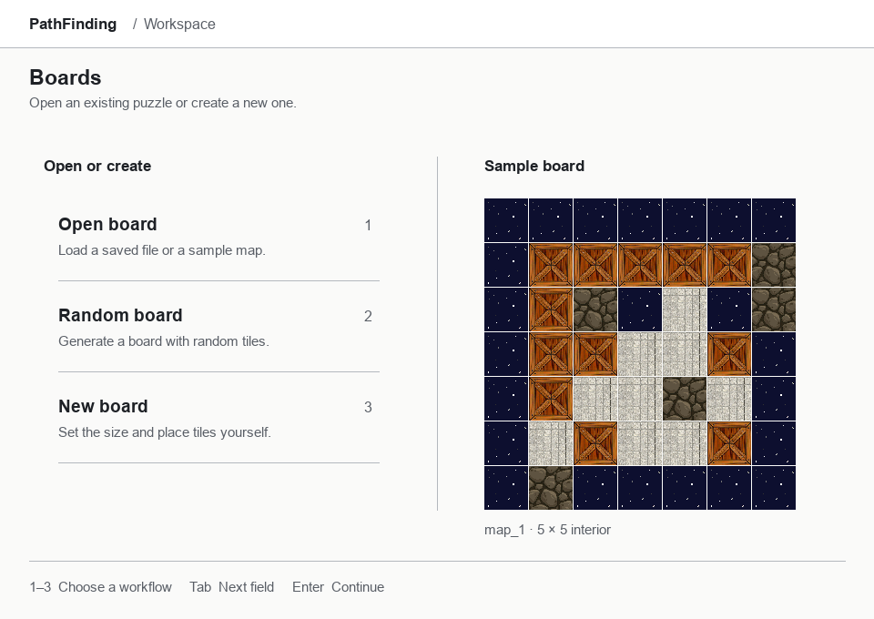
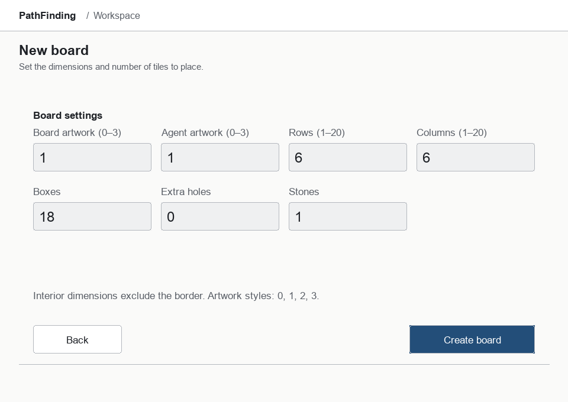
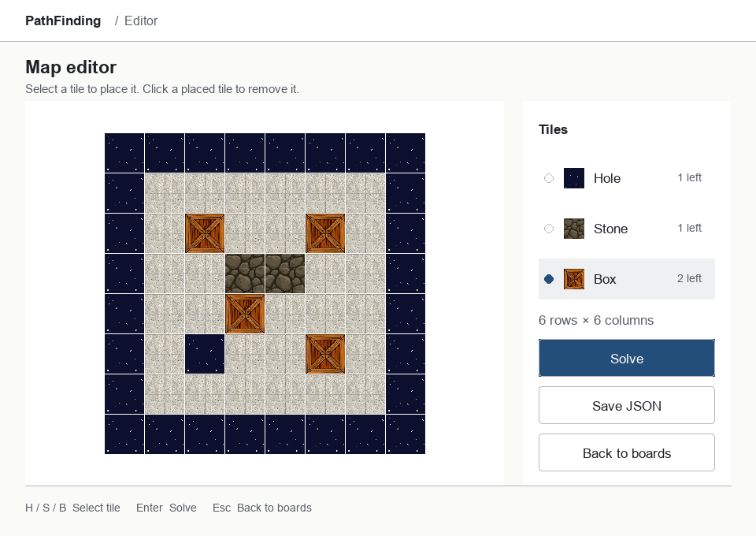
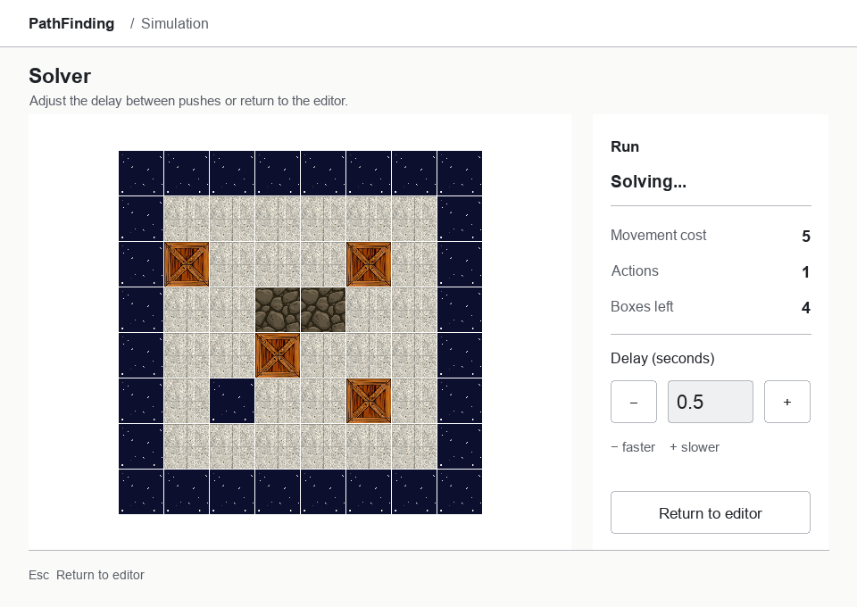

# PathFinding Emulator

A desktop puzzle editor and simulator for pushing boxes into holes. Design a
board, generate a seeded random board, or load one of the 14 original maps;
then watch an agent clear the boxes while the simulator tracks movement cost.
The four original artwork themes remain available.

## A modern desktop workspace

A restrained desktop interface pairs a centered puzzle board with clear editing
controls and live run statistics. These are **actual screenshots of the Pygame
application**, captured from the screens in this repository.



| Configure a board | Edit the puzzle |
|---|---|
|  |  |



Regenerate the screenshots after UI changes with
`python -m tools.capture_screenshots` from the repository root. The capture uses
Pygame's display-independent driver and does not require a desktop session.

## Setup and run

Use **Python 3.11–3.13**. Python 3.12 is recommended. A desktop display is needed
for the GUI; headless simulations and core tests do not import Pygame.
The pinned Pygame release has no Python 3.14 macOS wheel.

```sh
python3.12 -m venv .venv
source .venv/bin/activate
python -m pip install -r requirements.txt
python Main.py
```

On Windows, use `py -3.12 -m venv .venv`, then `.venv\Scripts\Activate.ps1`.
Alternatively, install the package with `python -m pip install .` and launch
`pathfinding-emulator`. `python -m pathfinding_emulator` also works.

Run a sample without a display:

```sh
python -m pathfinding_emulator --headless --map map_10 --algorithm A_Star
python Main.py --headless --height 2 --width 2 --seed 42
```

Failures return exit code 1 with a reason; invalid command syntax returns 2;
interruptions return 130. Successful runs print action count and total cost.

## Puzzle rules and agents

Maps are rectangular integer grids: `-2` stone, `-1` hole, `0` floor, `1` box.
The outer border must consist of holes or stones. A push moves an entire
contiguous chain of boxes one cell; its front box disappears into a hole.
Stones block movement. Actions use **row, column, direction**, with zero-based
coordinates including the border.

A push costs the chain length plus a starting penalty of 4. Continuing from the
next cell in the same direction can waive the penalty, unless the chain more
than doubles. Legacy blocked/no-box scoring is preserved for direct simulation
calls; supported agents choose only pushes that change the board.

- `random` (default): seeded edge-oriented pushes with a legal fallback.
- `A_Star`: uniform-cost search (A* with zero heuristic), minimizing simulator
  cost. The original edge heuristic was not admissible for this puzzle.
- `IDS`: iterative deepening with path-cycle prevention, minimizing action
  count within configured limits, rather than movement cost.

No-solution and resource-limit errors are distinct. A limit means solvability
is unknown. Large boards can require substantial search time and memory.
Random generation is bounded and does **not** guarantee solvability.

## Desktop workflow

Choose Load a board, Random board, or Design a board. Dimensions on both creation
screens mean **interior cells**. Artwork styles are 0–3. The GUI supports up to
20 × 20 interior cells and scales tiles to the desktop where possible.
Headless boards support up to 100 × 100.

In the editor, select a tile type and place the displayed remaining tiles.
Click an existing tile to remove it and return it to the quota. Stones may also
replace border holes. Save JSON creates a new file; Solve board starts the selected
agent. The solver’s minus/plus buttons adjust delay; Return to editor returns
to the original edited board. Completed and failed runs report their status.

Keyboard support: 1/2/3 chooses a launcher workflow, Tab focuses setup inputs,
Enter submits a form or completed
editor, Escape returns to the previous screen, and H/S/B selects hole/stone/box
in the editor. Minus/plus adjusts solver delay. Board placement still requires a mouse; full keyboard editing
and screen-reader accessibility are not implemented.

## Configuration

CLI arguments override the defaults below; there are no application environment
variables or configuration files. Settings are validated once at startup.

| Argument | Default | Meaning |
|---|---|---|
| `--headless` | off | Simulate without GUI imports |
| `--map` | none | File path or bundled sample name |
| `--height`, `--width` | 2, 2 | Interior size when generating a headless board |
| `--maps-dir` | `maps` in the launch directory | Directory for new JSON maps |
| `--algorithm` | `random` | `random`, `A_Star`, or `IDS` |
| `--seed` | system randomness | Reproducible generation and random agent choices |
| `--cell-size` | 50 | Requested GUI tile size, 20–100 pixels |
| `--delay` | 1 | Seconds between actions, 0–99 |
| `--fps` | 60 | Positive GUI frame-rate cap |
| `--max-steps` | 10000 | Maximum executed simulation actions |
| `--max-nodes` | 50000 | Maximum expanded search states |
| `--max-depth` | 100 | Maximum IDS action depth |

`--map` takes precedence over generated dimensions. Explicit files are loaded
first. Extensionless names try JSON then legacy pickle. Bare names and relative
`maps/` names also search the configured directory, then bundled samples.
Explicit absolute paths never fall back to a different sample. Artwork and
sample paths are anchored to the installed package, independent of launch
directory. The editor's tile count fields apply only to new designs.

## Map storage and compatibility

New saves are validated, human-readable JSON and use exclusive creation to avoid
overwriting an existing map. Original `.pickle` files remain unchanged. Legacy
loads accept only list/integer/memo opcodes, reject Python object construction,
limit memo indices, and enforce a 1 MiB file limit and board-size validation.
Use JSON when exchanging maps. There are no credentials, network services,
databases, or migrations.

`Main.py` and legacy class imports remain available through small compatibility
modules. See [architecture and compatibility](docs/architecture.md) for path
mappings and intentional corrections, including consistent random-map dimensions
and replacing unsupported experimental search internals.

## Development and verification

```sh
python -m pip install -r requirements-dev.lock
python -m pip install -e . --no-build-isolation --no-deps
python -m unittest discover -v
ruff check .
ruff format --check .
python -m build --no-isolation
python tools/check_wheel.py
python -m pip_audit -r requirements.txt --disable-pip --no-deps
```

Tests exercise simulator scoring, all 2×2 interior tile arrangements for both
searches, map security and concurrency, seeded generation, CLI failures, and
real Pygame screens with SDL dummy drivers. GUI tests skip explicitly if Pygame
is unavailable. The runtime has one exactly pinned dependency; the development
lock includes resolved tooling dependencies. No external test service is needed.

CI checks Python 3.11 on Linux and 3.13 on Windows, including packaging, an
installed-wheel smoke test, and dependency auditing. Dependency updates are
proposed through Dependabot pull requests; releases are not published
automatically. This is a local desktop application, so Docker and deployment
infrastructure are omitted.

## Architecture and ownership

`pathfinding_emulator/environment.py` owns rules and scoring; `maps.py` owns
validation/persistence/generation; `agents.py` owns bounded planning; `app.py`
assembles settings, random sources and perception callbacks and runs the UI or
headless simulation. `ui/` contains Pygame presentation and shared tile rendering.
Tests live in `tests/`; assets and sample maps are bundled with the package.
`other_agents.py` retains educational experimental policies with injected
randomness; these policies are not selected by the supported launcher.

Read [architecture](docs/architecture.md), [modernization report](docs/modernization.md),
and [agent guidance](AGENTS.md). No license was present in the original repository;
this modernization does not infer licensing rights for code or artwork.
