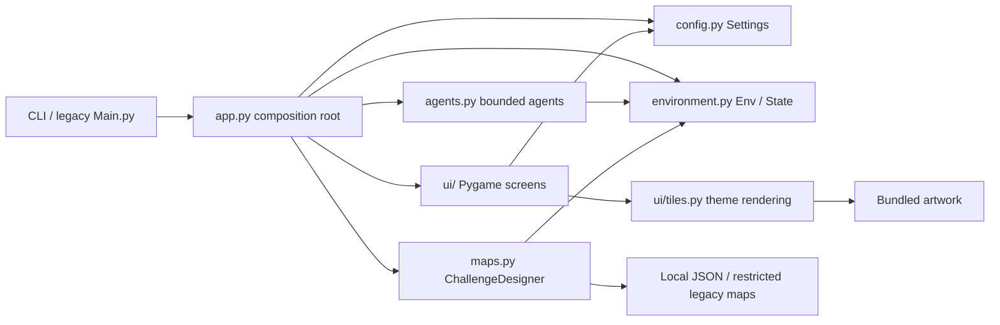

# Architecture and compatibility

The application has one local process and no external services. The diagram
below is derived from the final imports and call sites, and its editable source
is kept here. Archify was unavailable; no Archify-generated artifacts are claimed.

During map creation/loading, `ChallengeDesigner` produces a validated board.
The editor emits pending cell changes; the application applies them to the
designer and returns the updated board. Saving belongs to the designer rather
than the UI. Starting a solver copies the editor's board into `Env`, and supplies
`Env.send_map` to the agent. Search expansion uses copied environments and their
own scoring history. Each action is replayed by the same environment transition
before Pygame renders it.

The main GUI loop owns setup/editor/solver navigation. Search yields after each
expansion so the loop can work within an approximately 8 ms planning budget per
frame; a single expansion may exceed that budget. Animation pumps input events;
returning to the editor discards the simulation copy, keeping the edited board.
There are no worker threads or background services.

## Path changes

| Original path | Implementation path | Compatibility |
|---|---|---|
| `Main.py` | `pathfinding_emulator/app.py` | Original launch command preserved |
| `Env.py` | `pathfinding_emulator/environment.py` | Env/State imports preserved |
| `MapLoader.py` | `pathfinding_emulator/maps.py` | ChallengeDesigner import preserved |
| `Utils.py` | `pathfinding_emulator/utils.py` | Original helper imports preserved |
| `ai.py` | `pathfinding_emulator/agents.py` | Agent/Action/State imports preserved |
| `Astarr.py`, `simpids.py` | `pathfinding_emulator/agents.py` | Agent/Action entry points preserved |
| `MainGui.py`, `MapEditor.py`, `GuiSolver.py` | `pathfinding_emulator/ui/` | GUI/InputBox/MapEditor/Solver imports preserved |
| `images/` | `pathfinding_emulator/assets/` | Internal references updated; artwork bytes unchanged |
| `maps/` | retained; copies in `pathfinding_emulator/sample_maps/` | Original files unchanged; wheel includes samples |
| `.idea/`, `.vscode/`, `__pycache__/` | removed from version control | Machine-local configuration and generated files ignored |

Sample maps are intentionally duplicated (only about 2.6 KiB total) to retain
repository paths and support installed distributions. Assets have one copy.
No database or persistent user data was removed.

## Intentional corrections and scope

- Random-map dimensions now consistently mean interior dimensions, matching
  `base_map`, the design screen, and CLI help. The old random generator allocated
  a larger grid than its border calculations and could loop indefinitely.
- New saves are `.json`, with proper platform paths; existing `.pickle` files are
  still readable. Code expecting new pickle saves must adopt JSON.
- Env copying and equality no longer reference nonexistent `ex_dir`/`ex_move`
  fields. Construction now owns a board copy rather than aliasing caller memory.
- Unsupported experimental `Node`, `expand`, `do_action`, `heuristic`, `DLS`, and
  `A_asterisk` internals from old search modules are replaced by the documented
  `solve`, `search_steps`, and `Agent` APIs. External scripts using those internal
  functions need migration. The callable Agent/Action entry points are retained.
- Search exhaustion raises `NoSolutionError`; limits raise `SearchLimitError`;
  exhausted action plans raise `StopIteration` instead of an accidental IndexError.
- The default stochastic agent never intentionally chooses a blocked/no-box push.
  Random trajectories may differ from the old retry-based selection.
- Legacy scoring for direct blocked/no-box actions remains covered by fixtures.
  Direction constants, tile encodings and starting cost remain algorithm invariants.

The historical `other_agents.AgentInspiration` method names are retained for
educational experimentation. Randomness is injectable and box selection is exact,
but these stochastic methods do not guarantee completion or select only movable
pushes. Use the supported launcher for bounded execution.

## Packaging and operations

A setuptools wheel contains the core, compatibility modules, artwork, and samples.
The console entry point delegates to `app.main`. Settings, random sources and
perception callbacks are injected through constructors/functions. New saves use
an explicit directory rather than writing to installed package data. There is no
need for a container, cloud deployment, secrets manager, plugin registry, or DI
framework. Search memory remains dependent on the frontier size; the expansion
limit is a work bound, not a hard resident-memory quota.

## Desktop presentation

The launcher, setup forms, editor and solver share `ui/theme.py` for a neutral light palette,
typography, surfaces, buttons and workspace geometry. Board rendering accepts an
origin so drawing and pointer hit testing use the same centered rectangle.
Original artwork remains in the four existing themes. The desktop workspace is
at least 960 × 680 pixels; large boards grow it as needed, with cell sizes fitted
by the application to the available desktop. Solver statistics reflect actual
state and executed actions; planning and completion appear inside the window.
README screenshots are generated by `tools/capture_screenshots.py` using the
actual screen classes. No generated mockups or external image services are used.
